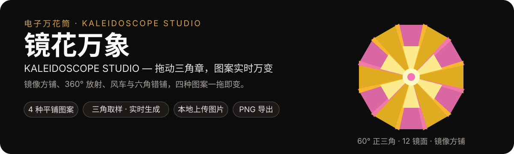
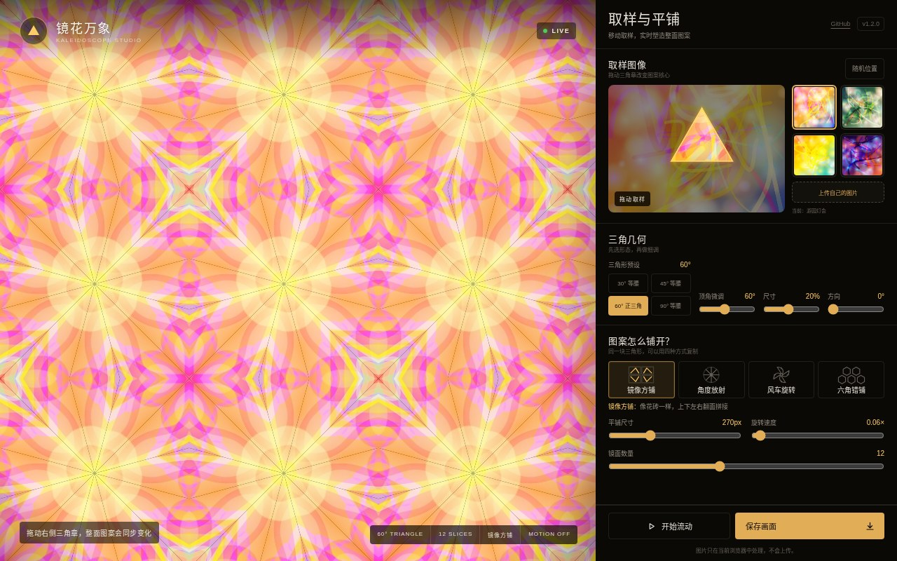
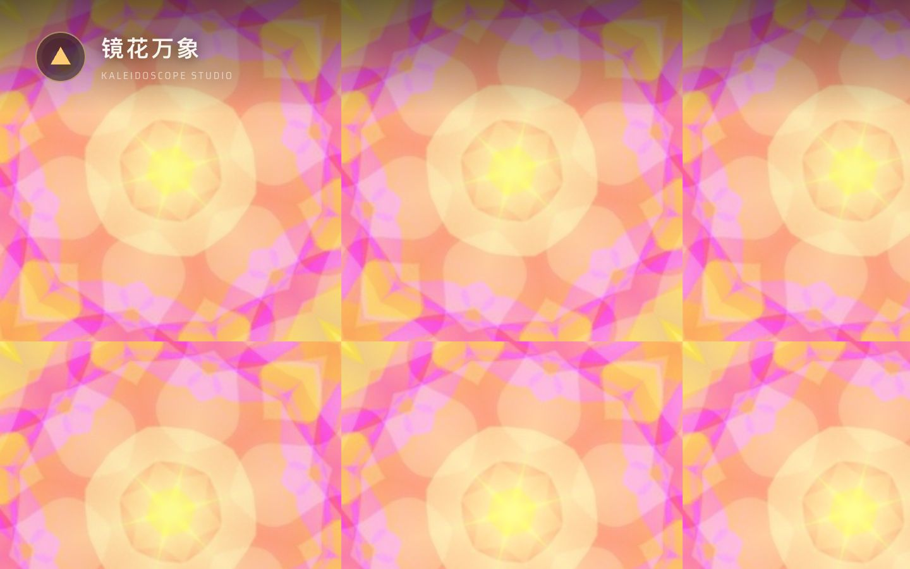

<p align="right"><a href="README.md">中文</a></p>

<p align="center">
  
</p>

<p align="center">
  <a href="https://xiaosang.cc/kaleidoscope-studio/">▶ Live Demo</a>
  ·
  <a href="https://holynova.github.io/kaleidoscope-studio/">GitHub Pages</a>
  ·
  <a href="https://github.com/holynova/kaleidoscope-studio">GitHub Repository</a>
</p>

Kaleidoscope Studio is a kaleidoscope in the browser: drag an adjustable triangular sampler over an image and watch mirrored, radial, pinwheel, and hexagonal patterns generate live. Upload your own image, export the wall as PNG — everything is processed locally in the browser, nothing is uploaded. Current version **v1.2.0**.

## Screenshots

<p align="center">
  
</p>

<p align="center">
  
</p>

## How It Works

1. **Pick a sample image**: 4 procedurally generated samples built in （游园灯会 Festival Lanterns, 玻璃花房 Glass Greenhouse, 柑橘汽水 Citrus Soda, 夜航星云 Night Nebula) — or upload your own image.
2. **Drag the triangle**: move the triangular sampler over the sample image and the whole pattern wall updates live; you can lock its position.
3. **Adjust the triangle geometry**: 4 apex angles (30° / 45° / 60° / 90°, isosceles and equilateral), plus fine-tuning, size, and rotation sliders.
4. **Pick a tiling**: 镜像方铺 (mirrored squares, flipped and joined like tiles), 角度放射 (radial), 风车旋转 (pinwheel), 六角错铺 (hexagonal offset).
5. **Tune the picture**: tile size, spin speed, and mirror count (12 by default); tap 「开始流动」 ("Start Motion") to set the pattern spinning.
6. **Save the picture**: tap 「保存画面」 ("Save Image") to export the current wall as a PNG.

## Run Locally

```bash
npm install
npm run dev      # Vite dev server
npm run build    # Type check + build, output in dist/
```

## Tech

- React 19 + TypeScript + Vite, a pure web app with no backend.
- Sample images are procedurally generated on Canvas (seed + palette); the pattern wall is drawn live on Canvas, with the triangular sample tiled via mirror / rotation transforms.
- All app logic is in the single file `src/App.tsx`; styles in `src/App.module.css`; `docs/` holds the build output (used for GitHub Pages).

```
src/App.tsx          All app logic: sampling, triangle geometry, four tilings, motion and export
src/App.module.css   Dark workbench styles
src/main.tsx         Entry
src/global.css       Global styles
docs/                Build output (GitHub Pages)
```
