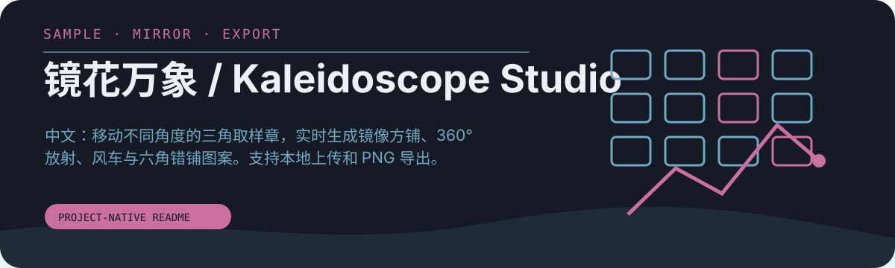
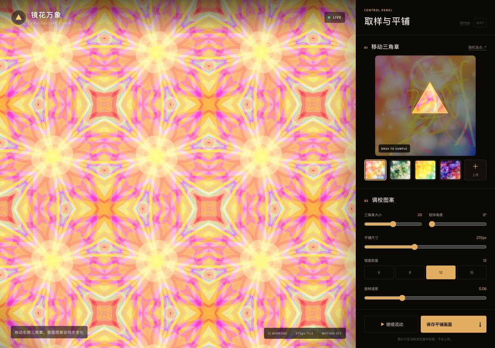

# 镜花万象 / Kaleidoscope Studio

中文：移动不同角度的三角取样章，实时生成镜像方铺、360° 放射、风车与六角错铺图案。支持本地上传和 PNG 导出。

<p align="center">
  
</p>


English: Move adjustable triangular samples to generate mirrored, radial, pinwheel, and hexagonal kaleidoscope patterns live.



[在线体验 / Live Demo](https://holynova.github.io/kaleidoscope-studio/) · [GitHub Repo](https://github.com/holynova/kaleidoscope-studio)

## 做一张万花筒图案

1. 使用示例图片，或选择本地图片。
2. 移动三角取样章，切换镜像方铺、放射、风车或六角错铺。
3. 观察实时结果，满意后导出 PNG。

## 本地运行 / Run locally

```bash
pnpm install --frozen-lockfile
pnpm dev
```

## 构建 / Build

```bash
pnpm build
pnpm preview
```

构建会先检查 TypeScript，再生成 Vite 产物。预览地址由终端输出。
