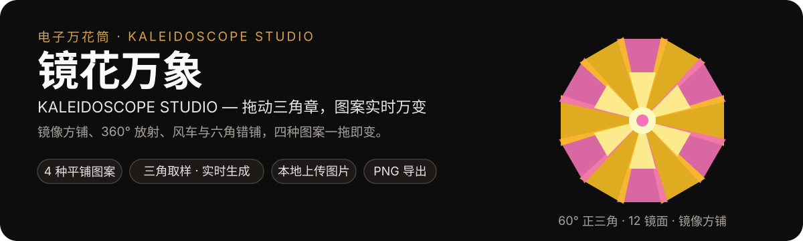
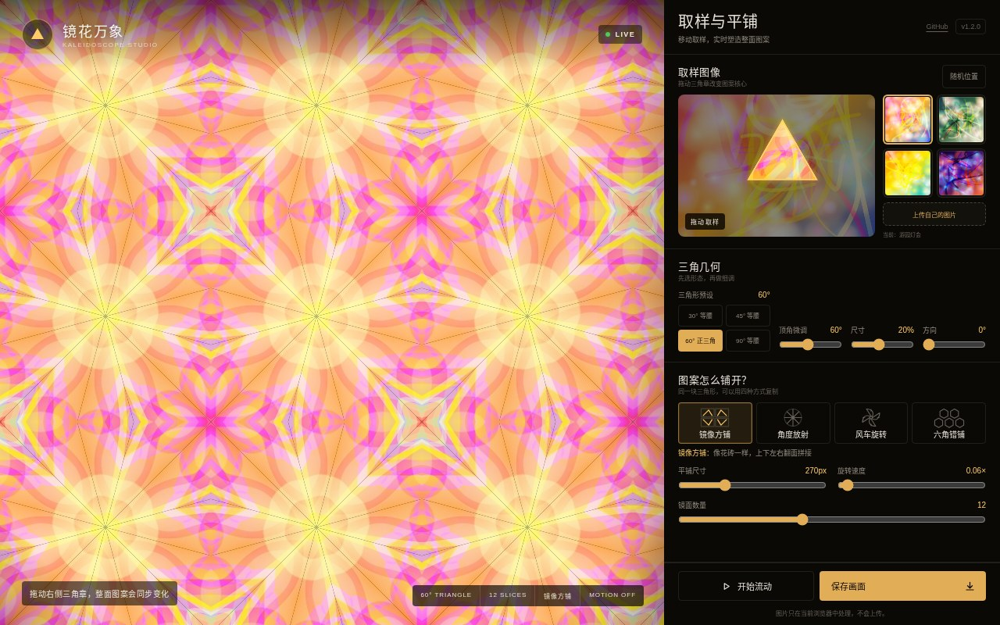
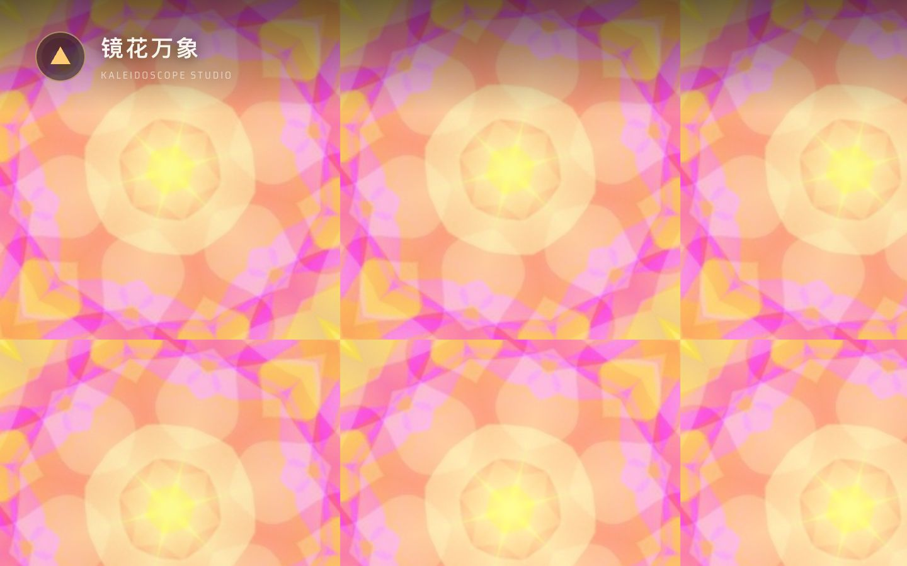

<p align="right"><a href="README.en.md">English</a></p>

<p align="center">
  
</p>

<p align="center">
  <a href="https://xiaosang.cc/kaleidoscope-studio/">▶ 在线体验</a>
  ·
  <a href="https://holynova.github.io/kaleidoscope-studio/">GitHub Pages</a>
  ·
  <a href="https://github.com/holynova/kaleidoscope-studio">GitHub 仓库</a>
</p>

镜花万象是一款电子万花筒：移动不同角度的三角取样章，实时生成镜像方铺、360° 放射、风车与六角错铺图案。支持本地上传图片与 PNG 导出，图片只在当前浏览器中处理，不会上传。当前版本 **v1.2.0**。

## 截图

<p align="center">
  
</p>

<p align="center">
  
</p>

## 玩法

1. **选一张取样图**：内置 4 张程序生成的取样图（游园灯会、玻璃花房、柑橘汽水、夜航星云），也可以上传自己的图片。
2. **拖动三角章**：在取样图上移动三角取样章，整面图案墙实时同步变化；可锁定位置。
3. **调三角几何**：4 种顶角（30° / 45° / 60° / 90° 等腰与正三角），另有顶角微调、尺寸、方向滑杆。
4. **选平铺方式**：镜像方铺（像花砖一样上下左右翻面拼接）、角度放射、风车旋转、六角错铺。
5. **调画面**：平铺尺寸、旋转速度、镜面数量（默认 12）；点「开始流动」让图案旋转起来。
6. **保存画面**：点「保存画面」，把当前整面图案导出为 PNG。

## 本地运行

```bash
npm install
npm run dev      # Vite 开发服务
npm run build    # 类型检查 + 构建，产物在 dist/
```

## 技术

- React 19 + TypeScript + Vite，纯网页应用，零后端。
- 取样图由 Canvas 程序生成（种子 + 配色方案）；图案墙用 Canvas 实时绘制，三角取样经镜像 / 旋转变换平铺。
- 单文件应用逻辑在 `src/App.tsx`，样式在 `src/App.module.css`；`docs/` 是构建产物（GitHub Pages 部署用）。

```
src/App.tsx          全部应用逻辑：取样、三角几何、四种平铺、流动与导出
src/App.module.css   深色工作台样式
src/main.tsx         入口
src/global.css       全局样式
docs/                构建产物（GitHub Pages）
```
